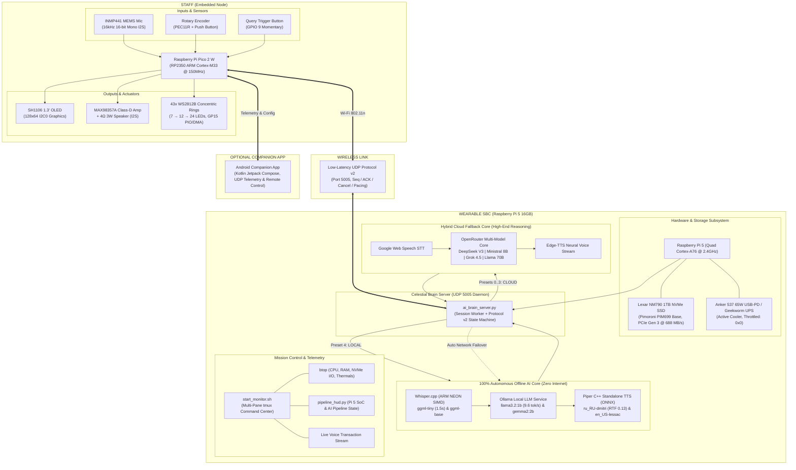

# CELESTIAL ENGINE Mk.V

**Autonomous Interactive AI Staff & Wearable Edge Compute System**  
Embedded RP2350 / Pico 2 W controller • Concentric 3D WS2812B runic rings • I2S duplex voice • Dual-Core Wearable Raspberry Pi 5 AI Server (100% Autonomous Offline + Hybrid Cloud).

---

## 🏛️ System Architecture



---

## 🧭 System Status Dashboard

| Subsystem | Hardware Platform | Operational State | Performance / Active Baseline |
| :--- | :--- | :--- | :--- |
| **Staff Embedded Core** | Raspberry Pi Pico 2 W (RP2350) | **OPERATIONAL** | 43 concentric LEDs (7→12→24), SH1106 OLED, INMP441 Mic, MAX98357A Amp |
| **Staff Firmware** | C/C++ (Official Pico SDK 2.3.1) | **1.0.18 Ready** | Protocol v2, 5 AI model presets, dual-AP Wi-Fi failover, standalone local oracle |
| **Wearable NVMe Storage** | Pimoroni PIM699 + Lexar NM790 1TB | **OPERATIONAL** | PCIe Gen 3 (688 MB/s), 100% MicroSD-free standalone boot, 0x0 throttling |
| **Autonomous Offline AI**| Raspberry Pi 5 (16 GB RAM) | **OPERATIONAL** | Whisper.cpp (1.5s) + Ollama Llama 3.2 1B (9.6 tok/s) + Piper TTS (0.47s) |
| **Cloud AI Core** | OpenRouter + Edge-TTS | **OPERATIONAL** | DeepSeek V3 (42), Ministral 8B (EDD), Grok 4.5 (GRK), Llama 3.3 70B (MRV) |
| **Real-Time Telemetry HUD**| Pi 5 Console (`tmux` + `btop`) | **OPERATIONAL** | Live SoC thermals, frequency, memory, NVMe bandwidth, and voice pipeline stages |
| **Android Companion** | Kotlin / Jetpack Compose | **OPTIONAL** | Remote staff control, time-sync, real-time telemetry over UDP |

---

## 🧠 AI Core Presets

The staff rotary encoder menu `[05] TARGET AI CORE` selects the intelligence target on the fly:

| Preset ID | Menu Name | Badge | Engine / Model | Execution Target | Typical Latency |
| :---: | :--- | :---: | :--- | :--- | :---: |
| **[0]** | `DEEP THOUGHT` | `[42]` | DeepSeek V3 (`deepseek-chat`) | Cloud (OpenRouter) | ~2.5 – 3.5 s |
| **[1]** | `EDDIE COMP` | `[EDD]`| Ministral 8B (`ministral-8b-2512`) | Cloud (OpenRouter) | ~2.0 – 3.0 s |
| **[2]** | `GROK 4.5` | `[GRK]`| Grok 4.5 (`x-ai/grok-4.5`) | Cloud (OpenRouter) | ~3.0 – 4.5 s |
| **[3]** | `MARVIN 70B` | `[MRV]`| Llama 3.3 70B Instruct | Cloud (OpenRouter) | ~3.5 – 5.0 s |
| **[4]** | `PI 5 LOCAL` | `[LOC]`| **Whisper Tiny + Llama 3.2 1B / Gemma 2B + Piper** | **100% Offline Pi 5** | **~3.5 – 5.5 s** |

> **Seamless Hybrid Fallback:** If a cloud model (0–3) is selected but Wi-Fi loses internet access, the Pi 5 server **automatically intercepts the failure** and routes the query through the local offline core without dropping the response!

---

## 🚀 Mission Control & Terminal HUD

A multi-pane `tmux` dashboard is pre-configured on the Raspberry Pi 5.

### Launching the Dashboard:
Connect via SSH and run:
```bash
hud
# or
celestial-hud
# or
bash /home/andr/celestial_engine_project/tools/start_monitor.sh
```

### Dashboard Layout:
```
┌──────────────────────────────────────┬──────────────────────────────────────┐
│                                      │  [pipeline_hud.py]                   │
│  [btop]                              │  • SoC Temp: 46.1°C | Clock: 2400MHz │
│  Real-time 4-core Cortex-A76 graphs  │  • NVMe: Lexar NM790 1TB (PCIe Gen 3)│
│  RAM usage, per-process trees        │  • Ollama: llama3.2:1b loaded in RAM │
│  NVMe read/write I/O throughput      │  • Pipeline Status: IDLE / RECORDING │
│                                      ├──────────────────────────────────────┤
│                                      │  [journalctl -u celestial-brain -f]  │
│                                      │  Live voice transactions, STT text,  │
│                                      │  LLM token speed & TTS synthesis     │
└──────────────────────────────────────┴──────────────────────────────────────┘
```

---

## 🛠️ Developer Quick Start

### 1. Build & Flash Staff Firmware (Pico 2 W)
```powershell
# From repo root on Windows
cmake --build firmware/build --target celestial_firmware --parallel 4
Copy-Item firmware\build\celestial_firmware.uf2 E:\  # (Where E:\ is RPI-RP2 drive)
```

### 2. Manage AI Brain Service on Raspberry Pi 5
```bash
# Check service status
sudo systemctl status celestial-brain.service

# View live transaction logs
sudo journalctl -u celestial-brain.service -f

# Restart brain server
sudo systemctl restart celestial-brain.service
```

### 3. Speech Safety & Adult Mode (18+ Uncensored Toggle)
By default, the AI Oracle operates in **PG-13 Family Safe Mode** with strict decency guardrails that forbid all profanity, obscenities, vulgarities, and slang across Russian, English, and German.

- **Toggle via Voice Command on Staff:**
  - **Enable Adult Mode (18+):** Hold QUERY and say *"Включи режим для взрослых"* or *"Активируй 18+"*. The Oracle confirms: *"Протоколы приличия отключены. Режим для взрослых активирован."*
  - **Disable Adult Mode (PG-13):** Hold QUERY and say *"Включи приличный режим"* or *"Выключи режим для взрослых"*. The Oracle confirms: *"Протоколы приличия восстановлены."*
- **Toggle via Config:** Set `"adult_mode": true` in `tools/brain_config.json`.
- **HUD Indicator:** The top-right Mission Control HUD displays `[PG-13]` (green) or `[18+]` (red) in real time.

### 4. Mission Control Dashboard (Pi 5)
```bash
# Launch interactive 3-pane dashboard (btop + zero-scroll HUD + journalctl)
hud
# Or run with restart flag:
./tools/start_monitor.sh --restart
```

---

## 📚 Key Documentation Index

- **Hardware Inventory & Matrix:** [`docs/hardware/inventory.md`](docs/hardware/inventory.md)
- **Global Wiring & GPIO Pinout:** [`docs/wiring/pinout.md`](docs/wiring/pinout.md)
- **UDP Network Protocol v2:** [`docs/protocol.md`](docs/protocol.md)
- **Experiment 041 — Standalone Offline AI:** [`docs/experiments/041-rpi5-standalone-offline-ai.md`](docs/experiments/041-rpi5-standalone-offline-ai.md)
- **Experiment 037 — NVMe Boot Migration:** [`docs/experiments/037-rpi5-nvme-stand-alone-migration.md`](docs/experiments/037-rpi5-nvme-stand-alone-migration.md)
- **Power Delivery Incident Report:** [`docs/hardware/rpi5_nvme_migration_incident_report.md`](docs/hardware/rpi5_nvme_migration_incident_report.md)
