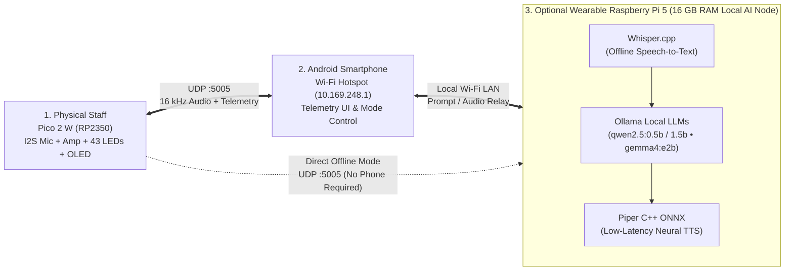
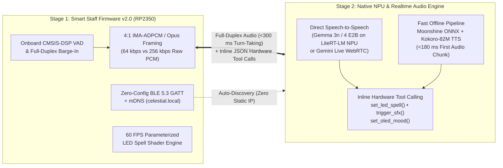

# Celestial Engine Mk.V

Embedded RP2350 controller, full-duplex I2S audio node, 43-LED concentric WS2812B display, and wireless UDP voice/telemetry system with Android and Raspberry Pi 5 host backends.

- **Web Simulator & Pinout Explorer:** [derandr.github.io/celestial_engine_project](https://derandr.github.io/celestial_engine_project/)
- **Latest Release:** [v1.3.0](https://github.com/DerAndr/celestial_engine_project/releases/latest) (`celestial_firmware.uf2` + `celestial_companion_v1.1.2.apk`)
- **Hardware Documentation:** [Inventory & BOM](docs/hardware/inventory.md) • [Pinout & Wiring](docs/wiring/pinout.md) • [UDP Protocol v2](docs/protocol.md)
- **Author:** Created by **Dr. Andrey Holz** — [LinkedIn](https://www.linkedin.com/in/andrey-holz/) • [GitHub (@DerAndr)](https://github.com/DerAndr)

---

## Overview

**Celestial Engine Mk.V** is a hardware and software platform built around the **Raspberry Pi Pico 2 W (RP2350)**. The staff operates as a real-time embedded peripheral node over Wi-Fi (UDP port `5005`) while maintaining a deterministic local fallback mode on Core 1 (21 onboard 8-bit chiptunes, 14 cosmic/R2-D2 sound effects, and 28 concentric LED patterns) if no external host is connected.

> **DIY Maker & Halloween Prop Disclaimer:** Celestial Engine Mk.V is a personal open-source embedded hardware project built as an interactive Halloween / cosplay prop and RP2350 engineering testbed. Festive LED effects and 8-bit chiptune interpretations are included strictly for non-commercial hobbyist demonstration.

---

## System Architecture & Real-Time Audio / Local LLM Streaming

### 1. Primary Architecture (Default): Staff ⇄ Android Smartphone Hotspot

In standard operation, only **two devices** are required: the physical **Staff (`Pico 2 W / RP2350`)** and an **Android Smartphone** running the companion app (`v1.1.2`) with its mobile Wi-Fi hotspot enabled (`10.169.248.1`).

```mermaid
flowchart LR
    subgraph STAFF["1. Physical Staff (Pico 2 W / RP2350)"]
        MIC["INMP441 I2S Mic\n(GP10-12 • 16 kHz PCM)"]
        PTT["Side QUERY Button\n(GP9 • Push-to-Talk)"]
        MCU["RP2350 Dual Cortex-M33\nCore 0: Wi-Fi UDP + OLED\nCore 1: PIO I2S + 43 LEDs"]
        SPK["MAX98357A I2S Amp + 3W Spkr\n(GP16-18 • 64 KB Ring Buffer)"]
        HUD["1.3\" SH1106 I2C OLED\n+ 43 WS2812B Rings (GP15)"]
        MIC --> MCU
        PTT --> MCU
        MCU --> SPK
        MCU --> HUD
    end

    subgraph PHONE["2. Android Smartphone (Primary Host • 10.169.248.1)"]
        HOTSPOT["Wi-Fi Hotspot Gateway\nBinary UDP v2 (:5005)"]
        STT["Speech-to-Text (STT)\n16 kHz PCM Stream Decoder"]
        LLM["Oracle Persona Engine\n(On-Device / Cloud / Local Relay)"]
        TTS["16 kHz TTS Pacer\n(1024 B / 32 ms UDP Chunks)"]
        HOTSPOT --> STT --> LLM --> TTS --> HOTSPOT
    end

    MCU -- "UDP :5005 Uplink\n16 kHz Mono PCM (640 B / 20 ms) + PTT" --> HOTSPOT
    HOTSPOT -- "UDP :5005 Downlink\n16 kHz TTS Audio + OLED Text + LED Effect ID" --> MCU
```

### 2. Optional Expansion Architecture: Staff ⇄ Android Phone ⇄ Wearable Raspberry Pi 5 (Local LLMs)

For **100% offline air-gapped operation** using local open-weight LLMs without draining the smartphone battery, an optional wearable **Raspberry Pi 5 (16 GB RAM + 1 TB NVMe SSD + X1209 UPS)** connects to the same smartphone Wi-Fi hotspot (`10.169.248.x`) and runs `celestial-brain.service`.



### 3. How Local LLMs & Real-Time UDP Streaming Work

1. **Push-to-Talk & I2S DMA Capture (Uplink):**
   - Holding the side `QUERY` button (`GP9`) transitions the staff state machine into `LISTENING`.
   - RP2350 **Core 1** reads 32-bit I2S samples from the `INMP441` microphone via `PIO0 SM1`, converts them to 16-bit 16 kHz mono PCM, and streams `640-byte` (`20 ms`) UDP v2 packets (`0x04` audio frames with CRC-16-CCITT) to port `5005`.
2. **Speech Recognition & Local LLM Generation:**
   - Releasing `QUERY` sends a `PTT_RELEASE` event (`0x05`) and switches the staff to `THINKING` (spinning cosmic vortex on the 43 LEDs).
   - The host (`Android` or optional `Raspberry Pi 5`) transcribes the recorded PCM stream via `Whisper.cpp` / Android STT and queries the selected persona using **Ollama** (`qwen2.5:0.5b`, `qwen2.5:1.5b`, `gemma4:e2b`) or in-browser **Transformers.js ONNX WebGPU** in the web simulator.
3. **Sentence-Chunked TTS & Visual Synchronization:**
   - As the LLM generates tokens, completed clauses are immediately synthesized into `16 kHz` 16-bit mono PCM audio via **Piper ONNX** (`<300 ms` latency) or Android TTS.
   - Before audio frames begin, the host sends an OLED text packet (`0x03`) and a thematic LED effect command (`0x01`) so the 1.3" `SH1106` display scrolls the response while the 43 concentric LEDs switch to the matching spell animation.
4. **Zero-Stutter 64 KB Ring Buffer Playback (Downlink):**
   - The host paces `1024-byte` (`32 ms`) PCM packets over UDP back to the staff.
   - RP2350 **Core 0** pushes incoming audio into a lock-free **64 KB circular ring buffer** (`2.04 seconds` of buffer capacity), and **Core 1** streams the samples via DMA through `PIO1 SM0` to the `MAX98357A` Class-D amplifier without blocking LED or OLED updates.

### 4. Next-Gen v2.0 Target Flow (2026 Best-Practice Roadmap — Planned Next Release)

While **Mk.V (v1.2)** uses a classic 3-step sequential pipeline (`I2S Raw PCM` → `STT` → `LLM Text` → `TTS` over static UDP), the upcoming **v2.0 architecture** upgrades the stack to the **2026 Edge AI & Wearable Best-Practice Flow**:



| Engineering Metric | Current Mk.V (`v1.2`) | Next-Gen Target (`v2.0` — 2026 Best Practice) |
| :--- | :--- | :--- |
| **Network Provisioning** | Static Hotspot / LAN IP (`10.169.248.1:5005`) | **Zero-Config `BLE 5.3 GATT` + `mDNS` (`celestial.local`)** |
| **Wireless Audio Codec** | Uncompressed `16 kHz` 16-bit PCM (`256 kbps`) | **4:1 `IMA-ADPCM` / `Opus` (`64 kbps`) + Sequence Jitter Buffer** |
| **Voice Interaction** | Half-Duplex Push-to-Talk (`GP9` button hold) | **Onboard `CMSIS-DSP` VAD + Full-Duplex Barge-In (Interruptible)** |
| **AI Inference Pipeline** | Sequential `STT → LLM → TTS` (`1.4–2.5 s` latency) | **Native Audio-to-Audio (`Gemma 3n/4` NPU / `WebRTC`) + `Kokoro-82M` (`<300 ms`)** |
| **Hardware Control** | Fixed LED/SFX IDs mapped per preset | **Inline LLM Function Calling (`set_led_spell`, `trigger_sfx`, `set_oled_mood`)** |

---

### Core Subsystems

1. **Staff Firmware (`firmware/`)** — Bare-metal C/C++ firmware built on the Raspberry Pi Pico SDK (RP2350 Dual Cortex-M33 @ 150 MHz):
   - **Core 0:** Manages `CYW43439` Wi-Fi connectivity, binary UDP v2 packet framing (`port 5005`, CRC-16-CCITT, FNV-1a header `0x811C9DC5`), `SH1106` 128×64 I2C1 OLED UI (`400 kHz`), and quadrature rotary encoder / push-to-talk GPIO interrupts.
   - **Core 1:** Runs timing-critical PIO state machines and DMA transfers: `PIO0 SM0` drives 43 addressable WS2812B LEDs (`800 kHz`), `PIO0 SM1` captures 16 kHz 16-bit mono PCM audio from the `INMP441` I2S microphone, and `PIO1 SM0` streams 16 kHz audio and 24 onboard chiptune sequences to the `MAX98357A` I2S Class-D amplifier.
2. **Android Companion App (`android/`)** — Native Android 15+ application (`v1.1.2`, Kotlin / Jetpack Compose):
   - Acts as a mobile Wi-Fi hotspot gateway (`10.169.248.1:5005`), handling voice queries, LLM/TTS streaming, remote LED/mode control, and real-time 43-LED state synchronization.
3. **Offline Raspberry Pi 5 Host (`tools/`)** — Local Linux service (`celestial-brain.service`) for Raspberry Pi 5 (16 GB RAM, 1 TB NVMe SSD):
   - Provides fully offline speech-to-text (`Whisper.cpp`), local LLM inference (`Ollama`: `qwen2.5:0.5b`, `qwen2.5:1.5b`, `gemma4:e2b`), and neural text-to-speech (`Piper` ONNX) over local Wi-Fi.
4. **Browser Digital Twin (`docs/`)** — Zero-dependency ES module web replica deployed via GitHub Pages:
   - Interactive 2D physical assembly view, direct RP2350 pinout map, 43-LED effect simulator, SH1106 OLED HUD, Web Audio 8-bit synth, microphone voice input, and an in-browser Oracle (scripted responses + optional local WebGPU/WASM inference).

---

## Verified Hardware Configuration

All physical components and electrical boundaries are documented in [`docs/hardware/inventory.md`](docs/hardware/inventory.md).

| Subsystem | Component | Interface / Spec | Power Domain |
| :--- | :--- | :--- | :--- |
| **Microcontroller** | Raspberry Pi Pico 2 W (`RP2350` + `CYW43439`) | Dual ARM Cortex-M33 @ 150 MHz, 802.11n Wi-Fi | 5V `VBUS` in, 3.3V logic |
| **LED Array** | 43× WS2812B (3 concentric rings: `7 + 12 + 24`) | `GP15` via `SN74AHCT125N` level shifter + `470 Ω` resistor | 5V `VBUS` + `1000 µF` cap (18% brightness cap) |
| **OLED Display** | 1.3" `SH1106` 128×64 I2C OLED (`0x3C`) | `I2C1` @ 400 kHz (`GP2` SDA, `GP3` SCL) | 3.3V (`Pin 36`) |
| **Rotary Encoder** | Bourns `PEC11R-4225F-S0024` (24 detents + switch) | Quadrature `GP6` (CLK), `GP7` (DT), `GP8` (SW) | 3.3V internal pull-ups |
| **Query Button** | Side momentary push-button (NO, Push-to-Talk) | `GP9` (Active-LOW) | 3.3V internal pull-up |
| **Microphone** | `INMP441` omnidirectional I2S MEMS module | `PIO0` I2S RX: `GP10` (SCK), `GP11` (WS), `GP12` (SD) | 3.3V (`Pin 36`), `L/R` tied to `GND` |
| **Audio Amplifier** | `MAX98357A` I2S Class-D amp + `4 Ω 3 W` speaker | `PIO1` I2S TX: `GP16` (BCLK), `GP17` (LRCLK), `GP18` (DIN) | 5V `VBUS` (9 dB default gain) |
| **Staff Power** | 5V USB power bank (`Intenso XS5000` / USB-C) | Direct feed to Pico `VBUS` (`Pin 40`) & star ground | Isolated 5V staff rail |
| **Wearable Host** | Raspberry Pi 5 16 GB + `Lexar NM790` 1 TB NVMe | `Geekworm X1209` UPS + 4× `Molicel INR18650-M35A` | Isolated wearable battery rail |

---

## RP2350 Pinout Summary

Verified against [`firmware/include/config.h`](firmware/include/config.h) and [`docs/wiring/pinout.md`](docs/wiring/pinout.md). All Pico 2 W GPIOs are strictly **3.3 V logic**.

| Signal / Module | Physical Pin | GPIO | Function | Notes |
| :--- | :---: | :---: | :--- | :--- |
| **OLED SDA** | Pin 4 | `GP2` | `I2C1 SDA` | 400 kHz Fast-Mode |
| **OLED SCL** | Pin 5 | `GP3` | `I2C1 SCL` | 3.3V pull-ups |
| **Encoder CLK (A)** | Pin 9 | `GP6` | Digital In (IRQ) | Internal pull-up |
| **Encoder DT (B)** | Pin 10 | `GP7` | Digital In | Internal pull-up |
| **Encoder SW** | Pin 11 | `GP8` | Digital In | Push-button confirm (Active-LOW) |
| **Query Button (PTT)** | Pin 12 | `GP9` | Digital In | Side push-to-talk trigger (Active-LOW) |
| **INMP441 SCK** | Pin 14 | `GP10` | `PIO0 I2S BCLK` | 512 kHz bit clock (16 kHz sample rate) |
| **INMP441 WS** | Pin 15 | `GP11` | `PIO0 I2S LRCLK` | 16 kHz word select |
| **INMP441 SD** | Pin 16 | `GP12` | `PIO0 I2S RX` | 16-bit mono PCM input via DMA |
| **WS2812B DIN** | Pin 20 | `GP15` | `PIO0 WS2812B` | Routed via `SN74AHCT125N` (`1A -> 1Y`) + `470 Ω` |
| **MAX98357A BCLK** | Pin 21 | `GP16` | `PIO1 I2S BCLK` | 512 kHz bit clock |
| **MAX98357A LRCLK** | Pin 22 | `GP17` | `PIO1 I2S LRCLK` | 16 kHz word select |
| **MAX98357A DIN** | Pin 24 | `GP18` | `PIO1 I2S TX` | 16-bit mono PCM output via DMA |
| **3V3 Logic Supply** | Pin 36 | `3V3(OUT)` | 3.3V Regulator Out | Powers `SH1106` OLED and `INMP441` mic |
| **5V Power Supply** | Pin 40 | `VBUS` | 5V USB Rail | Powers `WS2812B` rings, `SN74AHCT125N`, and `MAX98357A` |
| **Common Ground** | Pins 3, 8, 13, 18, 23, 28, 38 | `GND` | Star Ground | Shared 0V reference across staff modules |

---

## Repository Structure

```text
celestial_engine_project/
├── .github/workflows/     # CI pipelines for firmware, Android APK, and GitHub Pages
├── android/               # Android 15+ Companion App (Kotlin, Jetpack Compose, UDP server)
├── docs/                  # Technical documentation & GitHub Pages interactive simulator
│   ├── architecture/      # System and dual-host design specifications
│   ├── experiments/       # Hardware bring-up and verification logs (000..058)
│   ├── hardware/          # Verified Bill of Materials and power safety notes
│   ├── twin/              # Modular ES6 browser digital replica & pinout renderer
│   └── wiring/            # Pinout allocation and breadboard wiring guides
├── firmware/              # Raspberry Pi Pico 2 W (RP2350) C/C++ firmware
│   ├── include/           # Hardware configuration, protocol, audio, OLED, and LED headers
│   └── src/               # Dual-core main loop, PIO I2S drivers, SH1106, and UDP client
├── scripts/               # PowerShell/Bash build and audio verification scripts
├── tests/                 # C host probes and Python protocol regression tests
└── tools/                 # Raspberry Pi 5 offline AI daemon (Whisper.cpp, Ollama, Piper)
```

---

## Build & Development Quick Start

### 1. Build & Flash RP2350 Firmware (`firmware/`)
```powershell
cmake --build firmware/build --target celestial_firmware --parallel 4
Copy-Item firmware\build\celestial_firmware.uf2 <PICO_DRIVE_LETTER>:\
```

### 2. Build Android Companion APK (`android/`)
```bash
cd android
./gradlew assembleDebug
# Output: android/app/build/outputs/apk/debug/app-debug.apk
```

### 3. Run Verification & Acceptance Tests
```bash
# Protocol & firmware regression suite
python -m unittest discover -s tests -v

# Web simulator parity & safety checks
python tools/test_twin_acceptance.py
```

### 4. Run Local Web Simulator (`docs/`)
```bash
python -m http.server 8080 --directory docs
# Open http://localhost:8080
```

### 5. Raspberry Pi 5 Service Management (`tools/`)
```bash
sudo systemctl status celestial-brain.service
sudo journalctl -u celestial-brain.service -f
```

---

## Legal & Fair Use Notice

All monophonic 8-bit chiptune sequences included in the standalone synthesizer are simplified educational demonstrations for microcontroller research under Fair Use (17 U.S.C. § 107). All original musical compositions and trademarks belong to their respective owners. *"Korobeiniki"* (1861) is in the Public Domain.

## Author & License

Created by **Dr. Andrey Holz** ([LinkedIn](https://www.linkedin.com/in/andrey-holz/)). Released under the [MIT License](LICENSE). © 2026 Dr. Andrey Holz.
