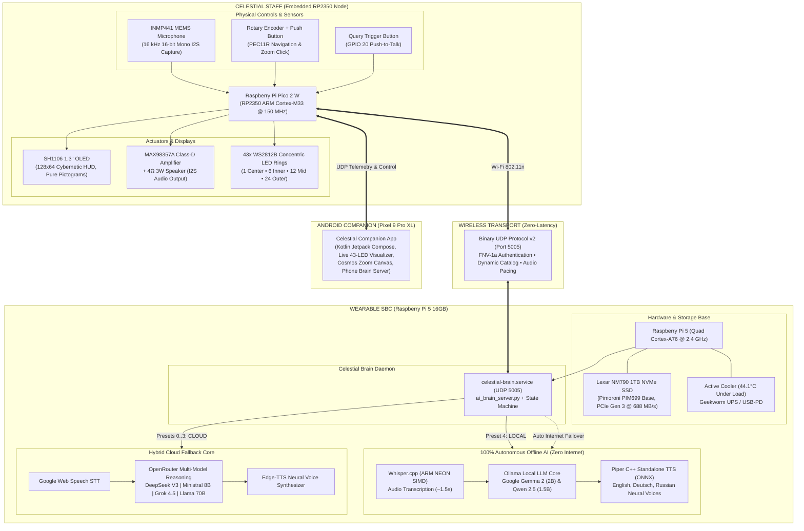
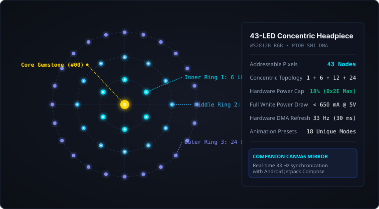
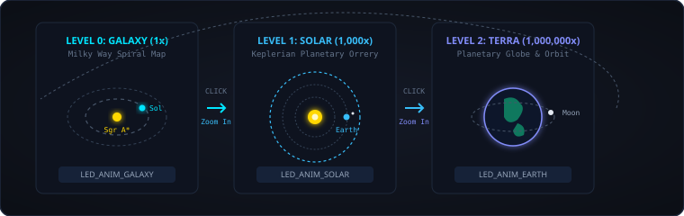
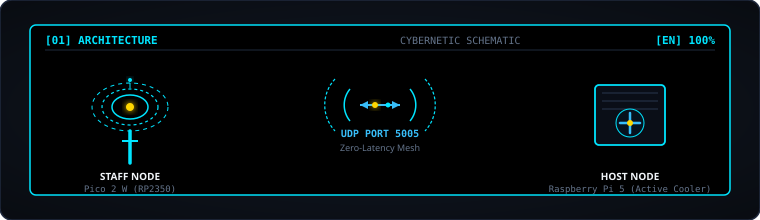

# 🌌 CELESTIAL ENGINE Mk.V

<div align="center">

<p align="center">
  <a href="firmware/"></a>
  <a href="tools/"></a>
  <a href="https://github.com/DerAndr/celestial_engine_project/releases/tag/v1.1.1-release"></a>
  <a href="https://derandr.github.io/celestial_engine_project/"></a>
  <a href="LICENSE"></a>
</p>
<p align="center">
  <a href="https://github.com/DerAndr/celestial_engine_project/actions"></a>
  <a href="tools/"></a>
  <a href="android/"></a>
  <a href="docs/hardware/inventory.md"></a>
</p>

**Autonomous Interactive AI Staff & Wearable Edge Compute System**  
*Embedded RP2350 M33 controller • 43-LED concentric WS2812B headpiece • Duplex I2S audio • Dual-Brain wearable Raspberry Pi 5 AI Server (100% Autonomous Offline + Hybrid Cloud Fallback) • Native Android Companion.*

[🎮 Live Web Simulator](https://derandr.github.io/celestial_engine_project/) • [📦 Official Releases (v1.1.1)](https://github.com/DerAndr/celestial_engine_project/releases/tag/v1.1.1-release) • [🗺️ Pinout Map](https://derandr.github.io/celestial_engine_project/interactive_map.html) • [Architecture](#-system-architecture) • [Concentric Rings](#-43-led-concentric-headpiece) • [Android App](#-native-android-companion) • [Quick Start](#-developer-quick-start)

</div>

---

> ### 🎮 **[Interactive Web Simulator (Digital Twin)](https://derandr.github.io/celestial_engine_project/)**
> Try Celestial Engine Mk.V directly in your browser:
> - **43 Concentric WS2812B LEDs** with 24 authentic animations (Doom Hellfire, Tetris Blocks, Imperial March, Zelda Triforce, Daft Punk, Matrix Rain).
> - **SH1106 Cybernetic OLED HUD** with 20 FPS marquee ticker, live clock, and Jukebox track selection.
> - **Sample-Accurate 8-Bit Chiptune Synth** powered by Web Audio API (authentic pulse wave harmonics).
> - **Tactile Rotary Encoder & Query Button** for interactive control.

---

## 📦 Production Release Artifacts (v1.1.1)

| Artifact | Target | Description | Download |
|---|---|---|---|
| **`celestial_firmware.uf2`** | Raspberry Pi Pico 2 W (RP2350) | C/C++ Firmware: 24-track Jukebox with early stop & seamless switching, 21 concentric LED animations, I2S duplex audio, UDP v2 client | [⬇️ Download UF2](https://github.com/DerAndr/celestial_engine_project/releases/download/v1.1.1-release/celestial_firmware.uf2) |
| **`celestial_companion_v1.1.0.apk`** | Google Pixel 9 Pro XL / Android 15+ | Native Kotlin Jetpack Compose app: Eye of the Oracle camera vision, Arcane Grimoire, Spell Forge (<20ms latency), Gemma 4 Voice AI | [⬇️ Download APK](https://github.com/DerAndr/celestial_engine_project/releases/download/v1.1.1-release/celestial_companion_v1.1.0.apk) |
| **`celestial-brain.service`** | Raspberry Pi 5 16GB (Lexar 1TB NVMe) | 100% Offline Edge AI: Whisper.cpp + Ollama (Llama 3.2 1B & Gemma 2B) + Piper C++ TTS | [📂 Explore Code](tools/) |

---

## 🏛️ System Architecture

Celestial Engine Mk.V operates as a high-speed, decentralized edge ecosystem. The staff is entirely self-sufficient with onboard voice synthesis, clockwork chronometer, and interactive navigation, communicating wirelessly over a binary UDP protocol with wearable and mobile AI hosts.



---

## 🧭 System Status Matrix

| Subsystem | Hardware Platform | Operational State | Performance / Active Specifications |
| :--- | :--- | :---: | :--- |
| **Staff Embedded Core** | Raspberry Pi Pico 2 W (RP2350) | **OPERATIONAL** | 150 MHz dual Cortex-M33, official Pico SDK 2.3.1, CYW43 Wi-Fi 802.11n |
| **Concentric Light Rings**| 43 WS2812B LEDs (1→6→12→24) | **OPERATIONAL** | GP15 PIO0 state machine, 33 Hz refresh, 18 distinct firmware animation modes |
| **Cybernetic OLED HUD** | SH1106 1.3'' I2C (128×64) | **OPERATIONAL** | Pure pictogram architecture, dynamic scrollable model catalog, responsive VU |
| **Wearable NVMe Storage**| Pimoroni PIM699 + Lexar NM790 1TB | **OPERATIONAL** | PCIe Gen 3 (688 MB/s), MicroSD-free standalone boot, 44.1°C active thermal |
| **Autonomous Offline AI**| Raspberry Pi 5 (16 GB RAM) | **OPERATIONAL** | Whisper.cpp + Ollama Gemma 2 (7.2 tok/s) + Piper C++ TTS (~4.5s roundtrip) |
| **Hybrid Cloud Fallback**| OpenRouter + Edge-TTS | **OPERATIONAL** | DeepSeek V3 (`42`), Ministral 8B (`EDD`), Grok 4.5 (`GRK`), Llama 70B (`MRV`) |
| **Mission Control HUD** | Pi 5 Console (`tmux` + `btop`) | **OPERATIONAL** | Real-time multi-pane telemetry: SoC thermals, memory, NVMe I/O, live STT/TTS |
| **Android Companion** | Pixel 9 Pro XL (Android 15+) | **OPERATIONAL** | Material 3 Edge-to-Edge, real-time 43-LED simulator, interactive Cosmos zoom |

---

## 🌟 43-LED Concentric Headpiece

The physical headpiece features **43 addressable WS2812B RGB LEDs** arranged in three concentric rings centered around a single core gemstone:

<p align="center">
  
</p>

### Ring Topology & Power Distribution

| Ring Tier | LED Count | Angular Spacing | Logical Indices | Logical Function | Hardware Rail |
| :--- | :---: | :---: | :---: | :--- | :---: |
| **Core Gemstone** | **1** | — | `Index #00` | Center focal anchor & voice prompt status | 5V / VBUS (18% Cap) |
| **Inner Ring 1** | **6** | 60° | `Indices #01 – #06` | High-speed vortex singularity & hours | 5V / VBUS (18% Cap) |
| **Middle Ring 2**| **12** | 30° | `Indices #07 – #18` | Chromatic rainbow & minutes indicator | 5V / VBUS (18% Cap) |
| **Outer Ring 3** | **24** | 15° | `Indices #19 – #42` | Star map orbits, plasma flares & seconds | 5V / VBUS (18% Cap) |

- **Electrical Safety Cap:** Firmware enforces an unbreakable **18% global brightness ceiling** (`0x2E` maximum channel value), drawing less than 650 mA on full white while keeping LEDs cool to the touch.

### 18 Firmware Animation Modes
All animations execute at **33 Hz** driven by PIO DMA:
`BREATHE` • `VORTEX` • `SNAKE` • `RAINBOW` • `PULSAR` • `PLASMA` • `STARS` • `VOICE` • `SOLAR` • `DATA_RECV` • `EXPAND_SPEECH` • `GALAXY` • `EARTH` • `HALLOWEEN` • `CLOCK_DIAL` • `CLOCK_HOURGLASS` • `CLOCK_PRISMATIC` • `CLOCK_ORRERY`.

---

## 🔭 Unified Cosmos Navigation

Astronomy, Keplerian orbits, and planetary navigation are consolidated into a single interactive viewport on both the staff OLED (`MODE_COSMOS`) and the companion Android app:

<p align="center">
  
</p>

1. **Level 0 — Milky Way Galaxy (`1x`)**: Spiral arm star map, rotating Perseus & Scutum-Centaurus arms, Sagittarius A* core, and blinking Sol beacon.
2. **Level 1 — Solar System Orrery (`1,000x`)**: Keplerian planetary orbits (Mercury, Venus, Earth with Moon, Mars), dynamic directional presence arrow pointing to Earth.
3. **Level 2 — Terra Planetary Globe (`1,000,000x`)**: Close-up globe with rotating continents, orbital Moon, and surface target reticle.
4. **Interactive Controls:**
   - **Click Encoder Switch:** Seamlessly transitions between zoom scales (`Galaxy` $\to$ `Solar` $\to$ `Terra` $\to$ `Galaxy`), triggers cosmic warp/portal chimes, and synchronizes the concentric LED rings (`LED_ANIM_GALAXY`, `LED_ANIM_SOLAR`, `LED_ANIM_EARTH`).
   - **Rotate Encoder:** Scrubs planetary orbits and celestial rotation in real time.

---

## 🖼️ Minimalist Cybernetic Architecture Scheme

Mode `[01] ARCHITECTURE` on the staff OLED renders a pure pictogram schematic with zero text clutter:

<p align="center">
  
</p>

- **Staff Node (Left):** Three concentric ring arcs, glowing center core, staff rod, and pulsing ethereal pinnacle sparks.
- **Wireless Link (Center):** Radiating antenna wave arcs with bidirectional data packets flying between nodes.
- **Host Node (Right):** Dynamic hardware silhouette reflecting active host — Raspberry Pi 5 with cooling fins and an animated 4-blade spinning fan, Smartphone silhouette with live equalizer audio bars, or Standalone IC chip.

---

## 🧠 Dual-Brain AI Engine

The staff rotary encoder menu `[04] AI CORE` dynamically switches the reasoning target between **Raspberry Pi 5 Brain** (`< PI 5 >`), **Companion Smartphone Brain** (`< PHONE >`), or **Mesh Auto-Detect** (`< AUTO >`), exposing the active host's live catalog on the OLED:

### Raspberry Pi 5 AI Core Catalog

| Preset ID | Menu Name | Badge | Engine / Model | Execution Target | Typical Latency |
| :---: | :--- | :---: | :--- | :--- | :---: |
| **[0]** | `DEEP THOUGHT` | `[42]` | DeepSeek V3 (`deepseek-chat`) | Cloud (OpenRouter) | ~2.5 – 3.5 s |
| **[1]** | `EDDIE (8B)` | `[EDD]`| Ministral 8B (`ministral-8b-2512`) | Cloud (OpenRouter) | ~2.0 – 3.0 s |
| **[2]** | `GROK 4.5` | `[GRK]`| Grok 4.5 (`x-ai/grok-4.5`) | Cloud (OpenRouter) | ~3.0 – 4.5 s |
| **[3]** | `MARVIN (70B)` | `[MRV]`| Llama 3.3 70B Instruct | Cloud (OpenRouter) | ~3.5 – 5.0 s |
| **[4]** | `QWEN 0.5B FAST` | `[Q05]`| **Qwen 2.5 0.5B (Distilled)** | **100% Offline Pi 5** | **~3.4 s** |
| **[5]** | `GEMMA 4 (E2B)` | `[G4]` | **Gemma 4 Distilled 2B** | **100% Offline Pi 5** | **~10.2 s** |
| **[6]** | `DEEPSEEK R1` | `[R1]` | **DeepSeek-R1 1.5B (Qwen Distill)** | **100% Offline Pi 5** | **~28.7 s (Thinking)** |
| **[7]** | `QWEN 1.5B CORE` | `[Q15]`| **Qwen 2.5 1.5B (Multilingual Core)** | **100% Offline Pi 5** | **~6.5 s** |

### Companion Smartphone AI Core Catalog (Pixel 9 Pro XL)

| Preset ID | Menu Name | Badge | Engine / Model | Execution Target | Typical Latency |
| :---: | :--- | :---: | :--- | :--- | :---: |
| **[0]** | `Gemma 4 (E2B)` | `[G4-MM]` | Gemma 4 Multimodal Vision Core | On-Device Phone (Local NPU) | ~1.5 – 2.5 s |
| **[1]** | `Gemma 4 Think` | `[G4THK]` | Gemma 4 Deep Reasoning Core | On-Device Phone (Local NPU) | ~2.0 – 3.5 s |
| **[2]** | `Gemini Nano` | `[NANO]` | Android AICore Gemini Nano | On-Device Phone (System Service) | ~1.0 – 1.8 s |
| **[3]** | `Pi 5 Core` | `[PI5]` | Relay to Pi 5 Gateway Core | Local Mesh Wi-Fi | ~3.5 – 5.5 s |

### Staff Rotary Encoder Operation
1. Rotate encoder to menu `[04] AI CORE` and click the encoder switch to enter Core selection.
2. The topmost item is the **Host Selector**: `HOST: < AUTO >`, `HOST: < PI 5 >`, or `HOST: < PHONE >`.
3. Click the encoder switch on the Host Selector row to toggle the target host. The staff instantly swaps its active catalog to the selected host and locks network queries to that target.
4. Rotate below the Host Selector to scroll through available models with the right-edge scrollbar track.
5. Click on any model to activate it. The concentric WS2812B LED rings will immediately flash the model's signature theme (Azure, Amber, Magenta, Steel, or Emerald).

### Local Models (Ollama on Pi 5 NVMe)
1. **Alibaba Qwen 2.5 0.5B (`qwen2.5:0.5b`)**: Ultra-distilled low-latency offline core (~3.4 s end-to-end latency).
2. **Google Gemma 4 Distilled 2B (`gemma4:e2b`)**: Rich retro-sci-fi reasoning (*"DON'T PANIC"*, Hitchhiker oracle personality).
3. **DeepSeek-R1 1.5B (`deepseek-r1:1.5b`)**: Distilled reasoning model with transparent chain-of-thought `<think>` tags.
4. **Alibaba Qwen 2.5 1.5B (`qwen2.5:1.5b`)**: High-speed multilingual polyglot (superb German & Russian reasoning).

> **Voice Model Switching:** Hold QUERY and say *"Switch to Qwen"*, *"Switch to Gemma"*, or *"Switch to DeepSeek"* (also supports German *"Wechsel zu Gemma"* and Russian *"Включи гемму"*) to switch local models on the fly without touching any keyboard.

### Language Dialects
- **English [EN]** — Default primary dialect across all prompts, system messages, and voice responses.
- **German [DE]** — Thorsten neural voice (`de_DE-thorsten-medium.onnx`).
- **Russian [RU]** — Dmitri neural voice (`ru_RU-dmitri-medium.onnx`).

### Speech Safety & Adult Mode (18+)
By default, the AI Oracle operates in **PG-13 Family Safe Mode** with strict decency guardrails that forbid profanity, obscenities, vulgarity, and slang across all languages.
- **Enable Adult Mode (18+):** Hold QUERY and say *"Enable adult mode"* or *"Adult mode on"*. The Oracle confirms: *"Attention! Decency filters disabled. Adult mode 18+ is now active."*
- **Restore Family Mode (PG-13):** Hold QUERY and say *"Disable adult mode"* or *"Family mode"*. The Oracle confirms: *"Decency protocols restored. Family-friendly polite mode is now active."*

---

## 📱 Native Android Companion

Located in [`android/`](android/), the companion app for Android 15/16/17 (optimized for Google Pixel 9 Pro XL) features:
- **Concentric LED Rings Visualizer**: Real-time 33 Hz Canvas rendering of all 43 physical LEDs with radial gradient halos and specular highlights, synchronized bidirectionally with Pico 2 W over UDP.
- **Interactive Cosmos Zoom Canvas**: Multi-scale astronomy viewport (`Galaxy` $\to$ `Solar` $\to$ `Terra`) with pinch/tap zoom and Keplerian orbits.
- **Phone Brain Server**: Transforms your smartphone into a portable AI Brain running Google Gemma on-device, servicing staff voice queries directly over Wi-Fi without needing a PC or Raspberry Pi 5.
- **Pure Pictogram Connection Scheme**: Interactive 3-node diagram (`Phone` $\leftrightarrow$ `Staff` $\leftrightarrow$ `Pi 5`) with one-tap mode switching.

---

## 📋 Firmware Modes Index

Rotary encoder rotation switches between the 13 unified operating modes on the staff OLED:

| Mode ID | Name | Function / Observable Behavior |
|:---:|:---|:---|
| **00** | `GUIDE` | Primary utilitarian HUD: real-time clock, Wi-Fi link status, active AI core, and audio gain |
| **01** | `ARCHITECTURE` | Pure pictogram cybernetic schematic: Staff, wireless link waves, and active Host hardware |
| **02** | `COSMOS` | Unified astronomy star map: click to zoom between Galaxy (1x), Solar (1k x), and Terra (1M x) |
| **03** | `CHRONOS` | Celestial Chronometer: Dial, Hourglass, Prismatic, and Orrery time displays with time adjust |
| **04** | `AI CORE` | Dynamic scrollable AI model selector (Deep Thought, Eddie, Grok, Marvin, Pi 5 Local) |
| **05** | `LINGUA` | Voice TTS and STT dialect selector (English default, Auto, Deutsch, Russian) |
| **06** | `VOLUME` | Master audio volume adjustment (0% to 100% logarithmic curve) |
| **07** | `RUNE LEDS` | WS2812B animation preset gallery (18 distinct concentric ring patterns) |
| **08** | `MIC VU` | Live INMP441 MEMS microphone peak VU meter and diagnostics |
| **09** | `JUKEBOX` | 8-bit retro chiptune player |
| **10** | `COSMIC FX` | Sci-Fi sound suite & R2-D2 astromech droids chirps, screams, and whistles |
| **11** | `ORACLE` | Built-in flash-stored speech prophecies (English, German, Russian) |
| **12** | `SYSTEM` | RP2350 hardware telemetry, CYW43 Wi-Fi RSSI, supply voltage, and uptime |

---

## 🔌 Hardware Wiring & Pinout

All connections use strictly **3.3 V logic** directly from the Raspberry Pi Pico 2 W:

| Peripheral | Pico Physical Pin | RP2350 Function | Supply Rail | Notes |
|:---|:---:|:---:|:---:|:---|
| **INMP441 SCK** | Pin 11 | GPIO 8 (PIO1 / I2S BCLK) | 3.3V | I2S Bit Clock (512 kHz) |
| **INMP441 WS** | Pin 12 | GPIO 9 (PIO1 / I2S LRC) | 3.3V | Word Select / Frame Sync (16 kHz) |
| **INMP441 SD** | Pin 14 | GPIO 10 (PIO1 / I2S RX) | 3.3V | Serial PCM Data |
| **INMP441 L/R** | Pin 18 (GND) | GND | GND | Left Channel Select |
| **MAX98357A BCLK**| Pin 16 | GPIO 12 (PIO0 / I2S BCLK) | 5V / VBUS | Shared Bit Clock |
| **MAX98357A LRC** | Pin 17 | GPIO 13 (PIO0 / I2S LRC) | 5V / VBUS | Shared Word Select |
| **MAX98357A DIN** | Pin 19 | GPIO 14 (PIO0 / I2S TX) | 5V / VBUS | Serial Audio Out |
| **WS2812B DIN** | Pin 20 | GPIO 15 (PIO0 SM1 / DMA) | 5V / VBUS | 43 Concentric LEDs (18% brightness cap) |
| **SH1106 SDA** | Pin 6 | GPIO 4 (I2C0 SDA) | 3.3V | 128×64 OLED Data |
| **SH1106 SCL** | Pin 7 | GPIO 5 (I2C0 SCL) | 3.3V | 128×64 OLED Clock |
| **Encoder A (CLK)**| Pin 21 | GPIO 16 (Digital In) | 3.3V (Pull-up) | PEC11R Quadrature A |
| **Encoder B (DT)** | Pin 22 | GPIO 17 (Digital In) | 3.3V (Pull-up) | PEC11R Quadrature B |
| **Encoder Switch** | Pin 24 | GPIO 18 (Digital In) | 3.3V (Pull-up) | Push-to-Confirm / Zoom Click |
| **Query Button** | Pin 26 | GPIO 20 (Digital In) | 3.3V (Pull-up) | Push-to-Talk Trigger |

---

## 📂 Repository Structure

```text
celestial_engine_project/
├── .github/
│   ├── workflows/             # GitHub Actions CI for Android & Core Engine
│   └── ISSUE_TEMPLATE/        # Bug report, feature request & hardware templates
├── android/                   # Native Android Companion (Kotlin & Jetpack Compose)
│   └── app/src/main/java/     # 43-LED visualizer, Cosmos canvas, Phone Brain server
├── docs/                      # Architecture, hardware inventory & 42 experiment logs
│   ├── architecture/          # Dual-brain AI & Android companion architecture
│   ├── experiments/           # Step-by-step breadboard verification journals
│   ├── hardware/              # Bill of Materials & incident reviews
│   └── wiring/                # Pinout table & safe logic diagrams
├── firmware/                  # Raspberry Pi Pico 2 W (RP2350) firmware
│   ├── include/               # Modular headers (net, audio, OLED, LEDs, fonts)
│   └── src/                   # main.c, leds.c, audio.c, sh1106.c, net_client.c
├── scripts/                   # Automated build & audio test harness scripts
├── tests/                     # Native C probes & Python regression test suite
└── tools/                     # Pi 5 AI Server, Ollama engine, Piper TTS & HUD scripts
```

---

## 🛠️ Developer Quick Start

### 1. Build & Flash Staff Firmware (Pico 2 W)
```powershell
# From repository root on Windows
cmake --build firmware/build --target celestial_firmware --parallel 4

# Flash the compiled UF2 to the connected Pico 2 W
Copy-Item firmware\build\celestial_firmware.uf2 <PICO_DRIVE_LETTER>:\
```

### 2. Verify Audio Harness (Native C Probes)
```powershell
powershell -ExecutionPolicy Bypass -File .\scripts\check-audio.ps1
```

### 3. Run Python Protocol & Regression Tests
```bash
python -m unittest discover -s tests -v
```

### 4. Manage AI Brain Service on Raspberry Pi 5
```bash
# Check systemd daemon status
sudo systemctl status celestial-brain.service

# View live streaming speech transactions
sudo journalctl -u celestial-brain.service -f

# Launch interactive 3-pane Mission Control HUD (btop + SoC thermals + logs)
hud
# or
bash tools/start_monitor.sh
```

### 5. Build Android Companion APK
```bash
cd android
./gradlew assembleDebug
# APK generated at android/app/build/outputs/apk/debug/app-debug.apk
```

---

## 📚 Technical Documentation

- **[PROJECT.md](PROJECT.md)** — Core engineering mission and milestone tracking.
- **[Hardware Inventory](docs/hardware/inventory.md)** — Complete Bill of Materials and module specifications.
- **[Global Pinout Guide](docs/wiring/pinout.md)** — Safe electrical wiring rules and pin assignments.
- **[Network Protocol v2](docs/protocol.md)** — Binary UDP framing, authentication, and packet layouts.
- **[Experiment 041 — Standalone Offline AI](docs/experiments/041-rpi5-standalone-offline-ai.md)** — Raspberry Pi 5 Whisper + Ollama + Piper benchmarks.
- **[Experiment 037 — NVMe Boot Migration](docs/experiments/037-rpi5-nvme-stand-alone-migration.md)** — Pimoroni Base and Lexar NM790 cutover.
- **[Companion Security Protocol](docs/experiments/040-android-companion-remote-security.md)** — Zero-leak FNV-1a authenticated remote control.
- **[Contributing Guide](CONTRIBUTING.md)** — Hands-on development rules, coding style, and safety protocols.
- **[Security Policy](SECURITY.md)** — Network security, threat model, and family guardrails.

---

## 📄 License

This project is licensed under the [MIT License](LICENSE) © 2026 Andrey Holz.

<div align="center">

*CELESTIAL ENGINE Mk.V — Built for autonomous discovery, retro-futuristic exploration, and cosmic wisdom.*  
**"DON'T PANIC."**

</div>
