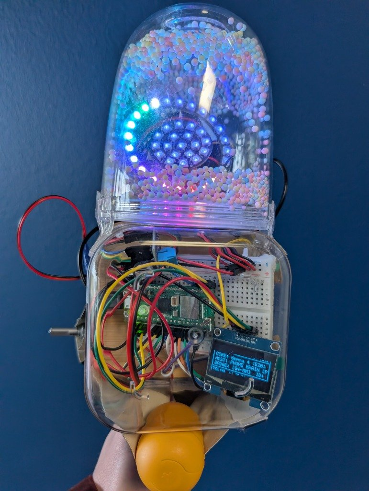
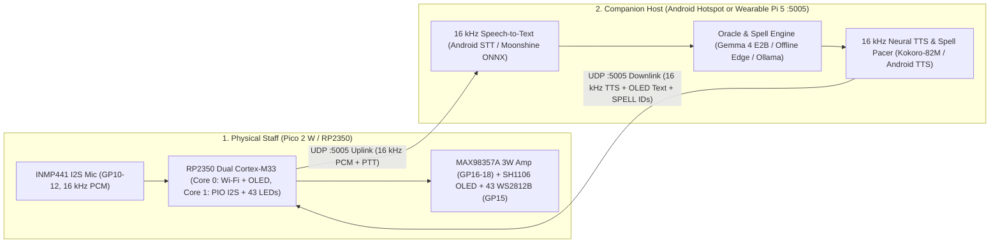
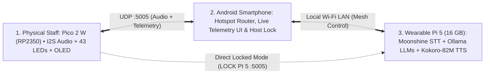
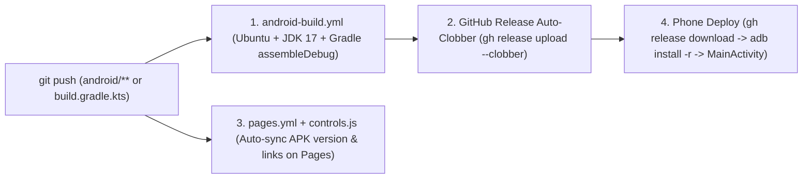

# Celestial Engine Mk.V

<p align="center">
  
  <br>
  <em>Physical Celestial Engine Mk.V Cyber-Flask Staff in Action — Gemma 4 &lt;E2B&gt; &amp; Phone Brain on 1.3&quot; SH1106 OLED, 43 Concentric WS2812B LEDs, and RP2350</em>
</p>

**Interactive AI Wizard Staff** powered by the **Raspberry Pi Pico 2 W (`RP2350` Dual Cortex-M33)** with full-duplex 16 kHz I2S audio (`INMP441` MEMS mic + `MAX98357A` 3W speaker), a **43-LED concentric WS2812B dome** (`7 + 12 + 24`), a `1.3" SH1106 OLED` HUD, wireless UDP v2 voice/telemetry streaming (`port 5005`), and multi-host local LLMs (**Android 15**, **Wearable Raspberry Pi 5**, and **In-Browser WebGPU/WASM**).

- 🌐 **Live Interactive Showcase (2 Modes — `✨ Quick Demo` & `🔬 Engineering Lab`):** [**derandr.github.io/celestial_engine_project**](https://derandr.github.io/celestial_engine_project/)
- 📦 **Latest Release (`v1.4.0`):** [**GitHub Releases (`v1.4.0-release`)**](https://github.com/DerAndr/celestial_engine_project/releases/latest) (`celestial_firmware.uf2` + auto-built `celestial_companion_v1.4.0.apk`)
- 📐 **Engineering Deep-Dives:** [System Architecture & CI/CD](docs/architecture.md) • [Pinout & Wiring](docs/wiring/pinout.md) • [Hardware BOM](docs/hardware/inventory.md) • [UDP Protocol v2](docs/protocol.md) • [Roadmap & Tasks](docs/tasks.md)
- 👤 **Author:** Created by **Dr. Andrey Holz** — [LinkedIn](https://www.linkedin.com/in/andrey-holz/) • [GitHub (@DerAndr)](https://github.com/DerAndr)

---

## 🌐 Try It in Your Browser (Dual-Mode GitHub Pages)

Open [**derandr.github.io/celestial_engine_project**](https://derandr.github.io/celestial_engine_project/) and switch between two tailored views at the top of the page:

1. **`✨ Quick Demo` (Fast Interactive Showcase):**
   - **🧠 Live In-Browser Local LLM (`Transformers.js v4` WebGPU / WASM SIMD):** Run **`SmolLM2-135M-Instruct`** or **`LiquidAI LFM2.5-350M`** 100% locally in your browser with real-time token streaming and zero API keys.
   - **🎭 6 Oracle Personas + Voice & Spell Casting:** Speak (`🎙️ Speak`, `en-US`) or type to **Machine God**, **Wise Archmage**, **Marvin Android**, **Cyberpunk Netrunner**, **Jack Pumpkin King**, or a **Custom Persona**.
   - **💡 28 Concentric LED Patterns & 🎵 21 8-Bit Chiptunes + 14 Sound FX:** 1:1 interactive replica of `led_patterns.c`, `chiptune_synth.c`, and the `128×64 SH1106 OLED` HUD.
2. **`🔬 Deep Engineering Lab` (Full Technical Workstation):**
   - Unlocks the interactive **2D RP2350 Pinout & Breadboard CAD Explorer**, **Binary UDP v2 Packet Framing Inspector**, **Duplex PIO/DMA I2S Audio Architecture**, and **Multi-Host Edge AI Diagrams**.

> **DIY Maker & Halloween Prop Disclaimer:** Celestial Engine Mk.V is a personal open-source embedded hardware project built as an interactive Halloween / cosplay prop and RP2350 engineering testbed under Fair Use.

---

## ⚡ Architecture at a Glance

| Execution Node | AI / Audio Stack | Primary Role |
| :--- | :--- | :--- |
| **1. Staff Controller (`firmware/`)** | **RP2350 Dual Cortex-M33** (`Core 0`: Wi-Fi UDP `:5005` + OLED + Event Dispatcher; `Core 1`: PIO I2S Mic/Amp + 64 KB Ring Buffer + 43 LEDs + 8-Bit Synth) | Real-time embedded peripheral & standalone 21-track / 28-LED fallback |
| **2. Android Companion (`android/`)** | **Kotlin / Compose (`v1.4.0`)** • On-Device ONNX (`Moonshine INT8`, `SenseVoice INT8` + emotion tags, `SmolLM2-135M INT8` LLM, `Kokoro-82M` voice profiles) + `Gemma 4 E2B` / `Gemini 2.5 Flash` | Primary mobile Wi-Fi Hotspot gateway (`:5005`), camera vision & remote control |
| **3. Wearable Pi 5 (`tools/`)** | **Raspberry Pi 5 (16 GB + 1 TB NVMe)** • `Moonshine INT8 ONNX` STT + `Ollama` (`Gemma 4 E2B`, `Qwen 2.5`, `Llama 3.2`) + `Kokoro-82M INT8` TTS + `:8080` Web Lab | Optional 100% air-gapped offline backpack co-processor (`celestial-brain.service`) |
| **4. Browser Twin (`docs/`)** | **ES6 + Web Audio + Transformers.js v4** (`SmolLM2-135M` / `LFM2.5-350M`) | Zero-install interactive web replica & pinout explorer |

### 1. Primary Operational Flow: Staff ⇄ Smartphone Hotspot (`UDP :5005`)



### 2. Optional 3-Node Offline Mesh: Staff ⇄ Android Phone ⇄ Wearable Raspberry Pi 5



---

## 🚀 Automated Android CI/CD, GitHub Releases & ADB Deployment

Every commit touching [`android/`](android/) or [`android/app/build.gradle.kts`](android/app/build.gradle.kts) drives a fully automated **zero-local-Android-Studio** cloud build, release publishing, GitHub Pages synchronization, and physical smartphone deployment pipeline (full specification in [`docs/architecture.md`](docs/architecture.md#3-android-companion-cicd-build-auto-release--adb-deployment-pipeline)):



### How the 4-Stage Pipeline Works Under the Hood

1. **Single Source of Truth ([`android/app/build.gradle.kts`](android/app/build.gradle.kts))**:
   - `versionName` (e.g., `"1.4.0"`), `versionCode`, and the pinned project debug signing certificate (`android/app/celestial-debug.keystore`) define the canonical version across the Android app, GitHub Releases, and the live GitHub Pages showcase while ensuring `adb install -r` upgrades seamlessly across cloud and local builds.
2. **Cloud APK Compilation & Auto-Release Clobbering ([`.github/workflows/android-build.yml`](.github/workflows/android-build.yml))**:
   - **Triggers**: Automatic on any `push` to `android/**`, on `release: [published]`, or manual `workflow_dispatch`.
   - **Headless Build & Unit Testing**: Runs `./gradlew testDebugUnitTest assembleDebug --no-daemon --stacktrace` (39 JUnit 4 tests) on `ubuntu-latest` with Temurin JDK 17 (`actions/setup-java@v4` with Gradle caching) — no local Android Studio or 15 GB Android SDK required on the developer workstation.
   - **Version Extraction & Release Overwrite**: Parses `versionName` via regex (`grep -oP 'versionName\s*=\s*"\K[^"]+' android/app/build.gradle.kts`), renames `app-debug.apk` to `celestial_companion_v${ANDROID_VER}.apk`, uploads a workflow artifact (`celestial-companion-v${ANDROID_VER}-apk`), and on `master` automatically overwrites the binary on the latest GitHub Release (`gh release upload "$LATEST_TAG" "celestial_companion_v${ANDROID_VER}.apk" --clobber`).
3. **Dual-Layer GitHub Pages Version Sync ([`.github/workflows/pages.yml`](.github/workflows/pages.yml) + [`docs/twin/controls.js`](docs/twin/controls.js))**:
   - **Build-Time HTML Patching (`pages.yml`)**: Triggered whenever `docs/**` **or** `android/app/build.gradle.kts` changes. Extracts `versionName` and runs `sed -i` on [`docs/index.html`](docs/index.html) before `actions/deploy-pages@v4` so static download links (`celestial_companion_v*.apk`) and version badges never go stale.
   - **Client-Side Runtime Sync (`syncLatestGitHubRelease()` in [`docs/twin/controls.js`](docs/twin/controls.js))**: Queries `https://api.github.com/repos/DerAndr/celestial_engine_project/releases/latest` on page load in the visitor's browser to dynamically bind the `#download-apk` and `#download-uf2` buttons to the newest published release assets.
4. **Dual-Path Smartphone Deployment (`Google Pixel 9 Pro XL` via `gh` CLI + `adb`)**:
   - Engineers and coding agents can either pull the cloud-compiled APK directly from GitHub Releases/Actions (`gh release download` / `gh run download`) into git-ignored `scratch/apk/` and install over USB/Wireless `adb install -r` (preserving user permissions and OpenRouter API keys), or build locally with `./gradlew assembleDebug`.

### 🔗 Where to Look (Workflows, Live Dashboards & Key Files)

| Component / Resource | Repository File | Live GitHub Dashboard / Endpoint |
| :--- | :--- | :--- |
| **Android Cloud Build & Release Upload** | [`.github/workflows/android-build.yml`](.github/workflows/android-build.yml) | [**Actions → Build Android Companion APK**](https://github.com/DerAndr/celestial_engine_project/actions/workflows/android-build.yml) |
| **GitHub Pages Auto-Version Deploy** | [`.github/workflows/pages.yml`](.github/workflows/pages.yml) | [**Actions → Deploy GitHub Pages**](https://github.com/DerAndr/celestial_engine_project/actions/workflows/pages.yml) |
| **Core Firmware & Python Protocol CI** | [`.github/workflows/ci.yml`](.github/workflows/ci.yml) | [**Actions → Core Engine CI**](https://github.com/DerAndr/celestial_engine_project/actions/workflows/ci.yml) |
| **Canonical Android Version (`versionName`)** | [`android/app/build.gradle.kts`](android/app/build.gradle.kts) | [**Latest GitHub Release & APK Asset**](https://github.com/DerAndr/celestial_engine_project/releases/latest) |
| **Browser Runtime Release Asset Sync** | [`docs/twin/controls.js`](docs/twin/controls.js) (`syncLatestGitHubRelease`) | [**Live Web Showcase (`#releases`)**](https://derandr.github.io/celestial_engine_project/#releases) |
| **Full Architecture & CI/CD Deep-Dive** | [`docs/architecture.md`](docs/architecture.md) | [**Deep Engineering Lab (`#tab-cicd`)**](https://derandr.github.io/celestial_engine_project/?mode=lab#architecture) |

### Quick Build & Deploy Commands

```powershell
# 1. RP2350 Modular C/C++ Firmware (firmware/)
cmake --build firmware/build --target celestial_firmware --parallel 4
picotool load -f -x firmware/build/celestial_firmware.elf

# 2A. Android Companion — Cloud Build (GitHub Actions) -> Pull APK -> ADB Install to Phone
gh run list --workflow=android-build.yml --limit 1
gh release download --pattern "celestial_companion_*.apk" -D scratch/apk --clobber
adb install -r (Get-Item scratch/apk/celestial_companion_v*.apk).FullName
adb shell am start -n com.celestial.companion/.MainActivity
Remove-Item -Recurse -Force scratch/apk

# 2B. Android Companion — Alternative: Download Directly from Specific Actions Run ID
gh run download <RUN_ID> -n celestial-companion-v1.4.0-apk -D scratch/apk
adb install -r (Get-Item scratch/apk/celestial_companion_v*.apk).FullName

# 2C. Android Companion — Local Gradle Build -> ADB Install
cd android && .\gradlew assembleDebug
adb install -r app/build/outputs/apk/debug/app-debug.apk

# 3. Run Regression & Web Twin Acceptance Suites (41 C/Python tests + Twin Parity)
python -m unittest discover -s tests -v
python tools/test_twin_acceptance.py
```

---

## 📂 Repository Map & Documentation Index

```text
celestial_engine_project/
├── .github/workflows/     # Automated CI: firmware, Android APK auto-release, and GitHub Pages
├── android/               # Android 15+ Companion App (Kotlin, Compose, DualEngineProvider, UDP :5005)
├── docs/                  # Documentation & Dual-Mode GitHub Pages Showcase (Quick Demo + Engineering Lab)
│   ├── architecture.md    # Modular firmware map, Dual-Core PIO/DMA, and Android CI/CD pipeline
│   ├── protocol.md        # Binary UDP Protocol v2 framing, opcodes, and stop-and-wait pacing
│   ├── tasks.md           # Master engineering roadmap & milestone tracker
│   ├── hardware/          # Bill of Materials (inventory.md) & Pi 5 NVMe setup
│   ├── twin/              # Modular ES6 browser simulator & Transformers.js Local LLM worker
│   └── wiring/            # Canonical RP2350 GPIO pinout & breadboard wiring guide (pinout.md)
├── firmware/              # Modular RP2350 C/C++ firmware (main.c [148L], event_dispatcher, ui_screens,
│                          # led_patterns, ws2812_driver, chiptune_synth, max98357a_driver, audio, net_client)
├── tests/                 # 41-test C unity harness & Python protocol regression suite
└── tools/                 # Wearable Pi 5 offline AI brain (Moonshine, Ollama, Kokoro-82M, Web Lab :8080)
```

---

## Legal, Fair Use & License

All monophonic 8-bit chiptune sequences included in the standalone synthesizer are simplified educational demonstrations for microcontroller research under Fair Use (17 U.S.C. § 107). *"Korobeiniki"* (1861) is in the Public Domain.

Created by **Dr. Andrey Holz** ([LinkedIn](https://www.linkedin.com/in/andrey-holz/) • [@DerAndr](https://github.com/DerAndr)). Released under the [MIT License](LICENSE). © 2026 Dr. Andrey Holz.
