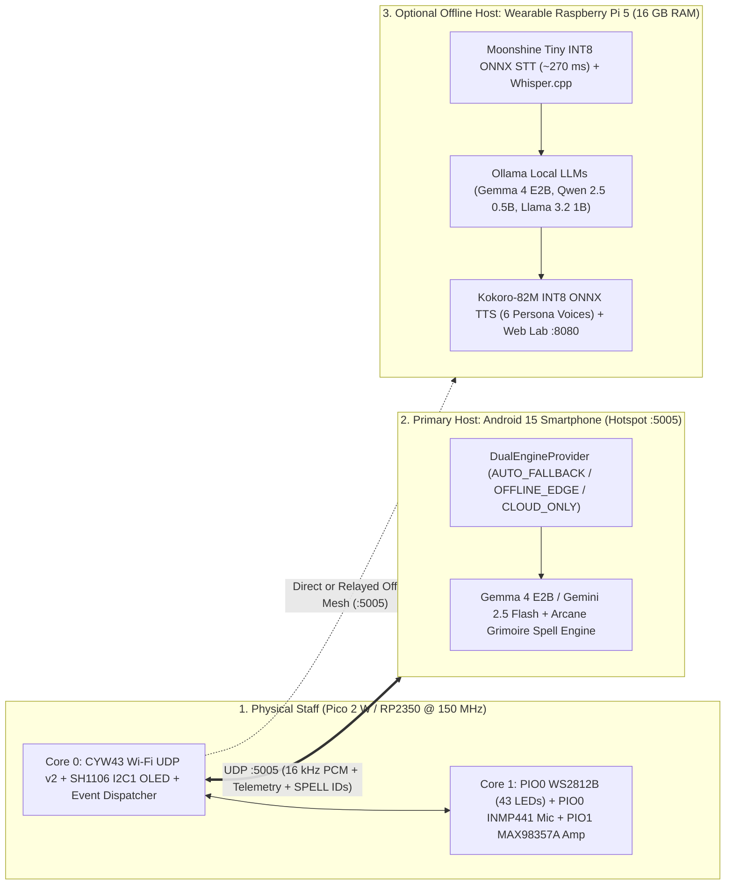
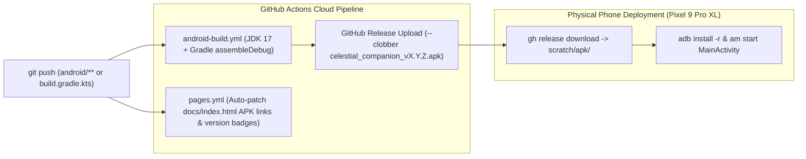

# Celestial Engine Mk.V — System Architecture, Modular Firmware & CI/CD Pipeline

This document provides the deep technical architecture for **Celestial Engine Mk.V (`v1.3.6`)**, covering the modular RP2350 C/C++ firmware layout, dual-core PIO/DMA audio and lighting pipelines, multi-host Edge AI routing (`Android 15`, `Raspberry Pi 5`, and `In-Browser WebGPU/WASM`), and the automated GitHub Actions Android build & deployment pipeline.

---

## 1. Multi-Host Topology & Edge AI Routing

**Celestial Engine Mk.V** separates real-time hardware peripherals on the handheld staff (`Raspberry Pi Pico 2 W / RP2350`) from heavy neural speech and language inference on wireless companion hosts over **UDP port `5005`** (`Brain Protocol v2`).



### Bidirectional Mesh Host Locking (`v1.3.4+`)
The staff supports three host-routing modes selectable from the on-staff `1.3" SH1106 OLED` menu (`[BRAIN]` screen) or remotely from the Android Companion app (`APP_COMMAND 0x20` with code `'H'`):
- **`0 = AUTO MESH` (`HOST_TYPE_NONE`)**: Automatically routes voice queries to the Raspberry Pi 5 when online, failing over seamlessly to the Android Companion phone.
- **`1 = LOCK PI 5` (`HOST_TYPE_PI5`)**: Locks voice queries strictly to the wearable Raspberry Pi 5 (`celestial-brain.service`) and disables phone query interception so background companion packets never hijack the active host.
- **`2 = LOCK PHONE` (`HOST_TYPE_PHONE`)**: Locks voice queries strictly to the Android smartphone (`Pixel 9 Pro XL`).

---

## 2. Modular RP2350 Firmware Architecture (`firmware/`)

Following the **Phase 8.1 Modular Firmware Refactoring**, `firmware/src/main.c` is a clean **148-line hardware entry point** that delegates state management, UI rendering, LED math, and audio synthesis to single-responsibility modules:

| Module | Lines | Core | Responsibility |
| :--- | :---: | :---: | :--- |
| [`firmware/src/main.c`](../firmware/src/main.c) | ~148 | Core 0 & 1 | Hardware initialization, GPIO IRQ attachment (`GP6–GP9`), `multicore_launch_core1(core1_entry)`, and main-loop delegation. |
| [`firmware/src/event_dispatcher.c`](../firmware/src/event_dispatcher.c) | ~1,158 | Core 0 | Finite state machine (`STATE_IDLE`, `STATE_LISTENING`, `STATE_PROCESSING`, `STATE_SPEAKING`), rotary encoder & PTT button handling, remote `APP_COMMAND` execution, USB CDC serial console, and 1 Hz telemetry heartbeat. |
| [`firmware/src/ui_screens.c`](../firmware/src/ui_screens.c) | ~820 | Core 0 | All `SH1106 128×64` OLED screens: `[VOICE]` Oracle dashboard, `[MUSIC]` jukebox, `[ARCANE]` LED selector, `[SFX]` cosmic sound bank, `[BRAIN]` host router, `[CHRONO]` clock, `[SYSTEM]` diagnostics, and `[GUIDE]` manual. |
| [`firmware/src/led_patterns.c`](../firmware/src/led_patterns.c) | ~640 | Core 1 | Pure mathematical rendering for all **28 concentric WS2812B patterns** (`7 Core + 12 Inner + 24 Outer = 43 LEDs`) plus the 8-LED spare indicator ring. |
| [`firmware/src/ws2812_driver.c`](../firmware/src/ws2812_driver.c) | ~110 | Core 1 | Low-level `PIO0 SM0` (`800 kHz` GRB) hardware framing, brightness scaling (`18%` thermal/current cap), and `SN74AHCT125N` level-shifted output on `GP15`. |
| [`firmware/src/chiptune_synth.c`](../firmware/src/chiptune_synth.c) | ~590 | Core 1 | Sample-accurate `16 kHz` monophonic pulse-wave synthesizer for all **21 onboard 8-bit chiptunes** and **14 cosmic / R2-D2 / spell sound effects**. |
| [`firmware/src/max98357a_driver.c`](../firmware/src/max98357a_driver.c) | ~140 | Core 1 | `PIO1 SM0` I2S TX driver (`GP16` BCLK, `GP17` LRCLK, `GP18` DIN) and DMA channel management for the `MAX98357A` Class-D amplifier. |
| [`firmware/src/audio.c`](../firmware/src/audio.c) | ~310 | Core 0 & 1 | Lock-free **64 KB circular playback ring buffer** (`32,768` 16-bit samples = `2.04 s` jitter cushion) and `PIO0 SM1` `INMP441` I2S microphone capture (`GP10–GP12`). |
| [`firmware/src/net_client.c`](../firmware/src/net_client.c) | ~680 | Core 0 | `CYW43439` Wi-Fi management, `lwIP` UDP v2 socket (`:5005`), stop-and-wait ACK/retry logic, and multi-host discovery. |

---

## 3. Android Companion CI/CD Build, Auto-Release & ADB Deployment Pipeline

The Android 15+ Companion App (`android/`) uses an automated **dual-workflow GitHub Actions pipeline** combined with local or cloud-artifact `adb` deployment.



### A. Quick Links: Workflows, Live Dashboards & Key Files

| Pipeline Stage | Source File in Repository | Live GitHub Dashboard / URL |
| :--- | :--- | :--- |
| **1. Cloud APK Compilation & Release Sync** | [`.github/workflows/android-build.yml`](../.github/workflows/android-build.yml) | [**Actions → Build Android Companion APK**](https://github.com/DerAndr/celestial_engine_project/actions/workflows/android-build.yml) |
| **2. GitHub Pages Version & Link Patcher** | [`.github/workflows/pages.yml`](../.github/workflows/pages.yml) | [**Actions → Deploy GitHub Pages**](https://github.com/DerAndr/celestial_engine_project/actions/workflows/pages.yml) |
| **3. Core Firmware & Python Protocol CI** | [`.github/workflows/ci.yml`](../.github/workflows/ci.yml) | [**Actions → Core Engine CI**](https://github.com/DerAndr/celestial_engine_project/actions/workflows/ci.yml) |
| **4. Canonical Version (`versionName`)** | [`android/app/build.gradle.kts`](../android/app/build.gradle.kts) | [**Latest GitHub Release (`celestial_companion_v*.apk`)**](https://github.com/DerAndr/celestial_engine_project/releases/latest) |
| **5. Client-Side Release API Sync** | [`docs/twin/controls.js`](twin/controls.js) (`syncLatestGitHubRelease`) | [**Live GitHub Pages Showcase (`#releases`)**](https://derandr.github.io/celestial_engine_project/#releases) |

### B. Single Source of Truth (`android/app/build.gradle.kts`)
- `versionName` (e.g., `"1.3.4"`) and `versionCode` in [`android/app/build.gradle.kts`](../android/app/build.gradle.kts) drive the APK filename, the GitHub Actions artifact name, the GitHub Release binary name, and the live GitHub Pages download badges.

### C. Cloud APK Compilation & Release Clobbering (`.github/workflows/android-build.yml`)
1. **Trigger**: Runs automatically on any push to `master` or `release` modifying `android/**` or `.github/workflows/android-build.yml` (or via manual `workflow_dispatch`).
2. **Headless Cloud Build**: Spins up `ubuntu-latest` with Temurin JDK 17 (`actions/setup-java@v4` with Gradle dependency caching), executing `./gradlew assembleDebug --no-daemon --stacktrace` without requiring a local Android Studio setup.
3. **Version Extraction & Artifact Naming**: Extracts `versionName` via regex (`grep -oP 'versionName\s*=\s*"\K[^"]+' android/app/build.gradle.kts`) and renames `app-debug.apk` to `celestial_companion_v${ANDROID_VER}.apk`.
4. **Automatic Release Asset Overwrite**: Queries the latest GitHub Release tag (`gh release view --json tagName -q .tagName`) and runs:
   ```bash
   gh release upload "$LATEST_TAG" "celestial_companion_v${ANDROID_VER}.apk" --clobber
   ```
   This guarantees that the latest GitHub Release always hosts the newest compiled APK binary alongside the workflow artifact (`celestial-companion-v${ANDROID_VER}-apk`).

### D. Dual-Layer GitHub Pages Version Synchronization (`.github/workflows/pages.yml` + `docs/twin/controls.js`)
1. **Build-Time HTML Patching (`pages.yml`)**: Triggered on any push to `docs/**` **or** `android/app/build.gradle.kts`. Before publishing `docs/` to GitHub Pages, `pages.yml` extracts `versionName` from `android/app/build.gradle.kts` and runs `sed -i` on `docs/index.html` to update `celestial_companion_v*.apk` URLs and `Android 15 Compose v*` badges automatically.
2. **Client-Side Runtime Verification (`controls.js`)**: On page load, `syncLatestGitHubRelease()` in [`docs/twin/controls.js`](twin/controls.js) queries `https://api.github.com/repos/DerAndr/celestial_engine_project/releases/latest` and binds `#download-apk` and `#download-uf2` directly to the live `browser_download_url` assets.

### E. Deploying to the Physical Smartphone (`Google Pixel 9 Pro XL`)

#### Path 1: Cloud-Built APK via `gh` CLI + `adb` (Zero Local Gradle Overhead)
```powershell
# 1. Verify the GitHub Actions build completed (or watch live via `gh run watch`)
gh run list --workflow=android-build.yml --limit 1

# 2A. Download the freshly built APK from the latest GitHub Release into git-ignored scratch/
gh release download --pattern "celestial_companion_*.apk" -D scratch/apk --clobber

# 2B. (Alternative) Download directly from a specific Actions Run artifact
# gh run download <RUN_ID> -n celestial-companion-v1.3.4-apk -D scratch/apk

# 3. Install over USB / Wireless ADB (-r preserves app data & API keys) and launch
adb install -r (Get-Item scratch/apk/celestial_companion_v*.apk).FullName
adb shell am start -n com.celestial.companion/.MainActivity

# 4. Clean up temporary artifact directory
Remove-Item -Recurse -Force scratch/apk
```

#### Path 2: Local Gradle Compilation + Direct `adb` Install
```powershell
cd android
.\gradlew assembleDebug
adb install -r app/build/outputs/apk/debug/app-debug.apk
adb shell am start -n com.celestial.companion/.MainActivity
```

---

## 4. Next-Gen v2.0 Target Architecture (2026 Roadmap)

| Engineering Metric | Current Mk.V (`v1.3.x`) | Next-Gen Target (`v2.0` — 2026 Best Practice) |
| :--- | :--- | :--- |
| **Network Provisioning** | Static Hotspot / LAN IP (`UDP :5005`) | **Zero-Config `BLE 5.3 GATT` + `mDNS` (`celestial.local`)** |
| **Wireless Audio Codec** | Uncompressed `16 kHz` 16-bit PCM (`256 kbps`) | **4:1 `IMA-ADPCM` / `Opus` (`64 kbps`) + Sequence Jitter Buffer** |
| **Voice Interaction** | Half-Duplex Push-to-Talk (`GP9` button hold) | **Onboard `CMSIS-DSP` VAD + Full-Duplex Barge-In (Interruptible)** |
| **AI Inference Pipeline** | Sequential `STT → LLM → TTS` (`1.4–2.5 s` latency) | **Native Audio-to-Audio (`Gemma 3n/4` NPU / `WebRTC`) + `Kokoro-82M` (`<300 ms`)** |
| **Hardware Control** | Tag-based `[SPELL: ...]` & preset LED/SFX IDs | **Inline LLM Function Calling (`set_led_spell`, `trigger_sfx`, `set_oled_mood`)** |

---

## 5. Related Engineering Documents
- **Hardware BOM & Power Domains**: [`docs/hardware/inventory.md`](hardware/inventory.md)
- **Canonical RP2350 Pinout & Breadboard Wiring**: [`docs/wiring/pinout.md`](wiring/pinout.md)
- **Binary UDP Protocol v2 Specification**: [`docs/protocol.md`](protocol.md)
- **Master Engineering Task List & Roadmap**: [`docs/tasks.md`](tasks.md)
