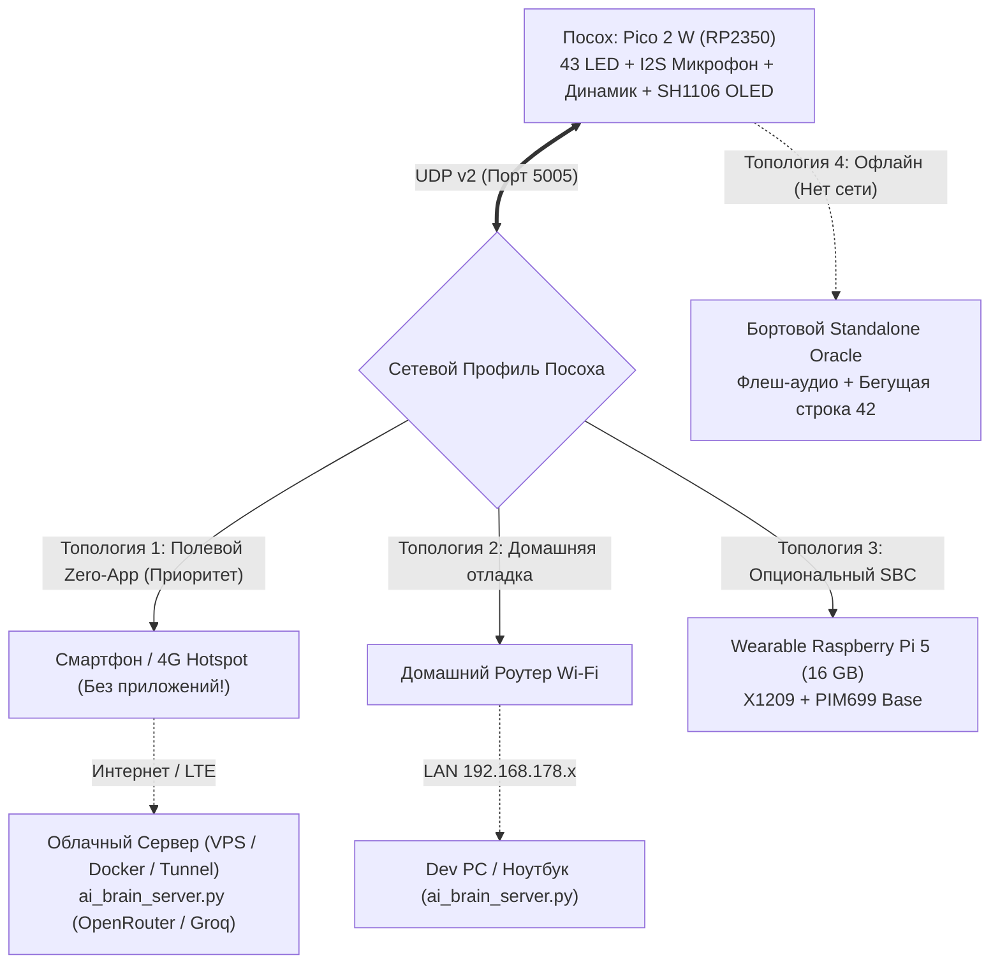

# Архитектура «Универсального Мозга»: Полная Независимость от Pi 5 и Android App

Документ описывает эволюцию серверной архитектуры проекта **CELESTIAL ENGINE Mk.V**: переход от жесткой привязки к носимому одноплатнику или мобильному приложению к **Универсальной Хост-Агностической Архитектуре (Universal Host-Agnostic & Cloud Brain Architecture)**.

---

## 1. Принцип Полной Независимости: Агностицизм к Хосту

Посох (Raspberry Pi Pico 2 W) взаимодействует с «Мозгом» по бинарному протоколу **UDP Protocol v2** на порту **5005**.  
Посох физически и логически отделен от вычислительного узла и **не зависит ни от Raspberry Pi 5, ни от специализированного приложения для Android**:

1. **Отказ от необходимости Android-приложения (Zero-App Tethering):**
   - Разработка нативного APK (Kotlin, Jetpack Compose, LiteRT, системные Foreground Services) исключена из обязательного критического пути.
   - Android OS агрессивно выгружает фоновые сервисы при экономии энергии (Doze Mode).
   - **Решение:** Смартфон (Google Pixel 9 Pro, iPhone или любой 4G/5G роутер) используется исключительно как **стандартная мобильная точка доступа (Wi-Fi Hotspot)** для раздачи интернета. На смартфоне **не требуется устанавливать никаких приложений**!
2. **Отказ от блокирующей зависимости от Raspberry Pi 5:**
   - После аппаратного инцидента с питанием NVMe на плате Geekworm X1002 (см. [Отчет 037](../hardware/rpi5_nvme_migration_incident_report.md)) система ожидает адаптер Pimoroni PIM699.
   - Носимый одноплатник с 4× 18650 аккумуляторами и активным охлаждением остается **опциональным автономным узлом**, но прогресс проекта не блокируется физическим железом.
3. **Автономный Оракул на борту Посоха (Standalone Resilience):**
   - Если сервер недоступен, нет Wi-Fi или разрядился телефон, посох **не превращается в бесполезный реквизит**.
   - В прошивку интегрирован **Standalone Offline Oracle**: при зажатии QUERY посох слушает микрофон, визуализирует звук концентрическим вихрем на 43 WS2812B светодиодах, а при отпускании — синтезирует космический отклик, воспроизводит локальные фразы из флеш-памяти (EN/DE/RU) и бегущую строку пророчеств на OLED-дисплее.

---

## 2. Четыре Топологии Развертывания



### Сравнительная Матрица Топологий

| Параметр | 1. Полевой Zero-App (Hotspot + Cloud) | 2. Домашний (Dev PC) | 3. Автономный Посох (Standalone) | 4. Носимый SBC (Pi 5) |
| :--- | :--- | :--- | :--- | :--- |
| **Необходимое железо** | Посох + Любой смартфон с Hotspot | Посох + ПК / Ноутбук | **Только Посох!** | Посох + Pi 5 + X1209 + PIM699 |
| **Приложения на телефоне** | **0 (Только включить хотспот)** | 0 | 0 | 0 |
| **Хост сервера** | Облачный VPS / Docker / Домашний ПК | Локальный компьютер | Встроенный RP2350 (C/C++) | Одноплатник в рюкзаке |
| **Качество AI** | Максимальное (OpenRouter, DeepSeek, Groq) | Максимальное (OpenRouter) | Процедурное бортовое (42, Кин-дза-дза) | Локальное либо гибридное |
| **Задержка ответа** | 0.8 – 1.4 с | 0.8 – 1.2 с | **0.05 с (Мгновенно)** | 1.5 – 3.0 с (локально) |
| **Масса носимого оборудования** | ~350 г (только посох + телефон) | ~350 г (посох) | **~350 г (только посох)** | ~950 г (посох + рюкзак с Pi 5) |

---

## 3. Двухпрофильная Сетевая Архитектура в Прошивке

Для того чтобы пользователю не требовалось перекомпилировать прошивку при выходе из дома, в `wifi_credentials.h` и `net_client.c` реализована поддержка двух профилей:

1. **Основной профиль (Primary):** Домашний Wi-Fi (`WIFI_SSID`, `WIFI_PASSWORD`, `BRAIN_SERVER_IP`).
2. **Резервный профиль (Fallback):** Точка доступа телефона (`WIFI_FALLBACK_SSID`, `WIFI_FALLBACK_PASSWORD`, `BRAIN_FALLBACK_SERVER_IP`).

### Логика автоматического переключения (Auto-Failover):
- При включении посох пытается подключиться к домашней сети.
- Если после 3 попыток домашняя сеть недоступна (пользователь вышел на улицу), клиент автоматически переключается на профиль точки доступа смартфона и перенаправляет трафик на облачный IP.
- Статус отображается на странице `[ SYSTEM ]` OLED-экрана:
  - `AP: <Имя активной сети>`
  - `HOST: <IP сервера>:<Порт>`
  - `BRAIN: READY` (если сервер отвечает) либо `STANDALONE` (если сервер недоступен).

---

## 4. Пайплайн «Мозга» без Приложений (Zero-App Brain Pipeline)

```text
[Посох: Микрофон INMP441]
           │ (UDP 16 кГц PCM mono через Wi-Fi Hotspot)
           ▼
[Сервер ai_brain_server.py (Cloud VPS / Домашний ПК)]
           │
           ├─► [STT: Google Web Speech / Groq Whisper API]
           │        │ (Текст запроса)
           │        ▼
           ├─► [LLM: OpenRouter (DeepSeek V3, Ministral, Grok, Llama 3.3)]
           │        │ (Текст ответа с юмором Автостопом по Галактике)
           │        ▼
           └─► [TTS: Edge-TTS (en-US, de-DE, ru-RU)]
                    │
                    ▼ (Сжатие / конвертация ffmpeg в 16 кГц PCM)
[Посох: Потоковый I2S буфер MAX98357A + OLED Marquee]
```

---

## 5. Обновленный План Реализации

### Фаза 1: Сетевая независимость и бортовой Оракул (Выполнено)
* [x] Добавлена поддержка двух Wi-Fi профилей (Дом + Мобильный Hotspot) в `net_client.c`.
* [x] Реализован **Standalone Offline Oracle**: зажатие QUERY без сервера запускает локальный замер голоса, анимацию вихря и выдает бортовое пророчество с локальным голосом из флеш-памяти.
* [x] Расширен вывод телеметрии в меню `[ SYSTEM ]` (активная AP, адрес сервера, готовность Оракула).
* [x] В `ai_brain_server.py` добавлены переменные окружения (`BRAIN_PORT`, `BRAIN_API_KEY`, `BRAIN_API_BASE`, `BRAIN_MODEL`) для запуска в облаке без правки JSON.
* [x] Созданы `tools/Dockerfile` и `tools/docker-compose.yml` для мгновенного облачного деплоя.

### Фаза 2: Облачный запуск и полевое тестирование
* [ ] Запуск `ai_brain_server.py` на облачном VPS (либо домашнем ПК с открытым UDP-портом / Cloudflare tunnel).
* [ ] Проверка подключения посоха к точке доступа смартфона на улице без использования ПК.
* [ ] Замер задержек STT -> LLM -> TTS в реальных условиях мобильной сети 4G/LTE.

### Фаза 3: Параллельный трек Pi 5 (Аппаратный резерв)
* [ ] Получение адаптера **Pimoroni PIM699 (NVMe Base)**.
* [ ] Монтаж на Raspberry Pi 5 с Lexar NM790 1 TB и проверка sustained write тестов.
* [ ] Развертывание `ai_brain_server.py` как автономного `systemd`-сервиса на Pi 5 в качестве резервного рюкзачного узла.
