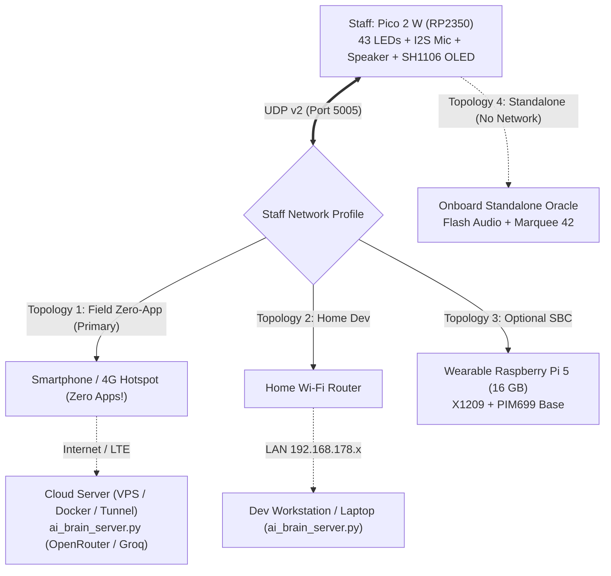

# "Universal Brain" Architecture: Host Independence from Pi 5 and Android App

This document describes the evolution of the server architecture for **CELESTIAL ENGINE Mk.V**: the transition from tight coupling with a wearable single-board computer or mobile app to a **Universal Host-Agnostic & Cloud Brain Architecture**.

---

## 1. Principle of Full Independence: Host Agnosticism

The staff (Raspberry Pi Pico 2 W) communicates with the "Brain" over binary **UDP Protocol v2** on port **5005**.  
The staff is physically and logically decoupled from the computing node and **depends neither on the Raspberry Pi 5 nor on a specialized Android application**:

1. **Zero-App Tethering:**
   - Native mobile APK development (Kotlin, Jetpack Compose, LiteRT, system Foreground Services) is removed from the critical path.
   - Mobile OS battery optimizations (e.g. Android Doze Mode) aggressively terminate background network daemons.
   - **Solution:** The smartphone (Google Pixel 9 Pro, iPhone, or any 4G/5G mobile hotspot) functions strictly as a **standard Wi-Fi Hotspot** for internet connectivity. **No client apps need to be installed or run on the phone**!
2. **Decoupling from Wearable Raspberry Pi 5 Blockers:**
   - Following the NVMe hardware power fault on the Geekworm X1002 board (see [Report 037](../hardware/rpi5_nvme_migration_incident_report.md)), the project moved to the Pimoroni PIM699 adapter.
   - The wearable single-board computer with 4× 18650 cells and Active Cooler remains an **optional autonomous node**, but physical hardware delays do not block progress.
3. **Onboard Staff Resilience (Standalone Offline Oracle):**
   - If the server is unreachable, Wi-Fi drops, or the phone battery drains, the staff **remains fully responsive**.
   - Integrated **Standalone Offline Oracle**: holding QUERY senses microphone input, visualizes audio via a concentric vortex across 43 WS2812B LEDs, and releasing it synthesizes a cosmic response, plays local flash-stored audio cues (English default, Deutsch, Russian), and scrolls retro-futuristic prophecies across the SH1106 OLED display.

---

## 2. Four Deployment Topologies



### Topology Comparison Matrix

| Parameter | 1. Field Zero-App (Hotspot + Cloud) | 2. Home (Dev PC) | 3. Standalone Staff | 4. Wearable SBC (Pi 5) |
| :--- | :--- | :--- | :--- | :--- |
| **Required Hardware** | Staff + Any smartphone hotspot | Staff + PC / Laptop | **Staff Only!** | Staff + Pi 5 + X1209 + PIM699 |
| **Apps on Phone** | **0 (Only enable hotspot)** | 0 | 0 | 0 |
| **Server Host** | Cloud VPS / Docker / Dev PC | Local computer | Onboard RP2350 (C/C++) | Wearable SBC in backpack |
| **AI Capability** | Maximum (OpenRouter, DeepSeek, Groq) | Maximum (OpenRouter) | Procedural onboard (42, Sci-Fi) | Local offline or hybrid |
| **Response Latency** | 0.8 – 1.4 s | 0.8 – 1.2 s | **0.05 s (Instantaneous)** | 1.5 – 3.0 s (local) |
| **Carried Equipment Mass** | ~350 g (staff + phone in pocket) | ~350 g (staff) | **~350 g (staff only)** | ~950 g (staff + Pi 5 backpack) |

---

## 3. Dual-Profile Network Architecture in Firmware

To eliminate the need for firmware recompilation when transitioning between home and mobile environments, `wifi_credentials.h` and `net_client.c` implement two network profiles:

1. **Primary Profile:** Home Wi-Fi (`WIFI_SSID`, `WIFI_PASSWORD`, `BRAIN_SERVER_IP`).
2. **Fallback Profile:** Mobile hotspot (`WIFI_FALLBACK_SSID`, `WIFI_FALLBACK_PASSWORD`, `BRAIN_FALLBACK_SERVER_IP`).

### Automated Failover Logic:
- On boot, the staff attempts to associate with the primary home network.
- If after 3 connection attempts the home network is unavailable (user stepped outside), the client automatically fails over to the mobile hotspot profile and points traffic to the cloud server IP.
- Network status is reported on the `[ SYSTEM ]` OLED card:
  - `AP: <Active Network SSID>`
  - `HOST: <Server IP>:<Port>`
  - `BRAIN: READY` (when server heartbeats respond) or `STANDALONE` (when disconnected).

---

## 4. Zero-App Brain Pipeline

```text
[Staff: INMP441 Microphone]
           │ (UDP 16 kHz PCM mono via Wi-Fi Hotspot)
           ▼
[Server ai_brain_server.py (Cloud VPS / Dev PC / Pi 5)]
           │
           ├─► [STT: Google Web Speech / Groq Whisper API / Local Whisper]
           │        │ (User query text)
           │        ▼
           ├─► [LLM: OpenRouter (DeepSeek V3, Ministral, Grok, Llama 3.3) / Ollama]
           │        │ (Douglas Adams retro-sci-fi response text)
           │        ▼
           └─► [TTS: Edge-TTS / Piper (en-US default, de-DE, ru-RU)]
                    │
                    ▼ (ffmpeg stream conversion to 16 kHz 16-bit PCM)
[Staff: Streaming MAX98357A I2S buffer + OLED Marquee]
```

---

## 5. Implementation Roadmap

### Phase 1: Network Independence and Onboard Oracle (Completed)
* [x] Add dual Wi-Fi profile support (Home + Mobile Hotspot) in `net_client.c`.
* [x] Implement **Standalone Offline Oracle**: holding QUERY without server connectivity triggers local sound level meter, vortex animation, and delivers onboard prophecy with local flash speech.
* [x] Expand telemetry display in `[ SYSTEM ]` menu (active AP, server address, Oracle readiness).
* [x] Add environment variables to `ai_brain_server.py` (`BRAIN_PORT`, `BRAIN_API_KEY`, `BRAIN_API_BASE`, `BRAIN_MODEL`) for containerized deployment.
* [x] Create `tools/Dockerfile` and `tools/docker-compose.yml` for cloud deployment.

### Phase 2: Cloud Deployment and Field Validation
* [ ] Deploy `ai_brain_server.py` on cloud VPS (or home server with forwarded port / tunnel).
* [ ] Verify staff hotspot pairing outdoors without workstation dependencies.
* [ ] Benchmark STT -> LLM -> TTS roundtrip latency over 4G/LTE mobile networks.

### Phase 3: Parallel Pi 5 Track (Hardware Standalone Reserve)
* [x] Receive **Pimoroni PIM699 (NVMe Base)** adapter.
* [x] Mount on Raspberry Pi 5 with Lexar NM790 1 TB and verify sustained write stress tests.
* [x] Deploy `ai_brain_server.py` as autonomous `systemd` service on Pi 5 as backpack companion node.
